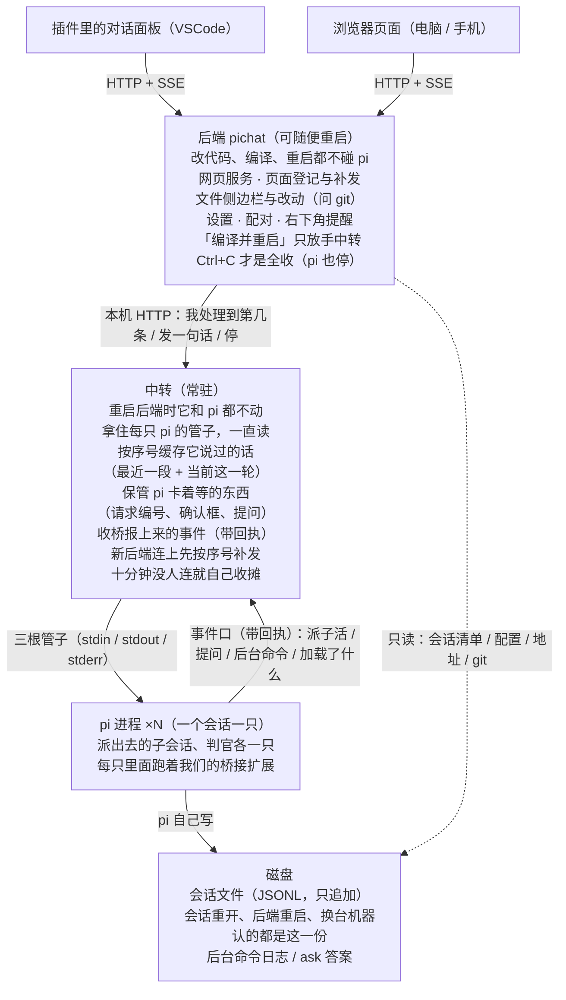

# Pi Chat

与 [pi coding agent](https://pi.dev) 对话的插件与网页端：会话跑在后端里，插件里的对话面板、浏览器页面都是它的客户端，看到的是同一份会话。

两边看的是同一份会话，只是换了外壳。会话重开、后端重启、换台机器接着看，认的都是磁盘上那份会话文件。

图里「中转」这一段是正在做的那一层（还没做完）；其余都是现在就在跑的。原来的安装与使用说明不再放这儿，要看就从 git 历史里翻。
