# Pi Chat

与 [pi coding agent](https://pi.dev) 对话的插件与网页端：会话跑在后端里，插件里的对话面板、浏览器页面都是它的客户端，看到的是同一份会话。

```mermaid
%%{init: {"flowchart": {"wrappingWidth": 420}}}%%
flowchart TD
    Panel["插件里的对话面板（VSCode）"]
    Page["浏览器页面（电脑 / 手机）"]

    Backend["后端 pichat（可随便重启）<br/>网页服务 · 页面登记与补发<br/>文件侧边栏与改动（问 git）<br/>设置 · 远程机器 · 右下角提醒<br/>「编译并重启」在同一终端里编译、起回来<br/>Ctrl+C 全收（pi 也停）"]

    Pi["pi 进程 ×N（一个会话一只）<br/>派出去的子会话、判官各一只<br/>每只里面跑着我们的桥接扩展"]

    Disk["磁盘<br/>会话文件（JSONL，只追加）<br/>会话重开、后端重启、换台机器<br/>认的都是这一份<br/>后台命令日志 / ask 答案"]

    Panel -->|"HTTP + SSE"| Backend
    Page -->|"HTTP + SSE"| Backend
    Backend -->|"三根管子（stdin / stdout / stderr）"| Pi
    Pi -->|"stderr 上的暗号：派子活 / 提问 / 后台命令 / 加载了什么"| Backend
    Pi -->|"pi 自己写"| Disk
    Backend -.->|"只读：会话清单 / 配置 / 地址 / git"| Disk
```

两边看的是同一份会话，只是换了外壳。会话重开、后端重启、换台机器接着看，认的都是磁盘上那份会话文件。

pi 是后端起的子进程：后端重启，它们跟着重开（会话与历史都在磁盘上那份会话文件里，不丢）。
「编译并重启」那颗按钮只换后端这一个进程：在终端里敲 `pichat` 时，留在终端里的是「看着后端的那一层」，
它在同一个终端里拉代码、编译、把后端起回来，窗口和日志都不关（见 `bin/pichat-restart.js` 的 `supervise`）。
原来的安装与使用说明不再放这儿，要看就从 git 历史里翻。
