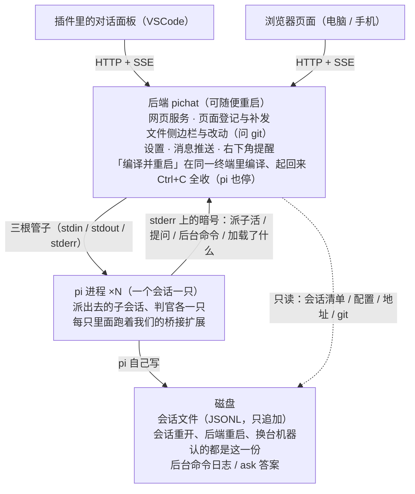

# Pi Chat

与 [pi coding agent](https://pi.dev) 对话的插件与网页端：会话跑在后端里，插件里的对话面板、浏览器页面都是它的客户端，看到的是同一份会话。

两边看的是同一份会话，只是换了外壳。会话重开、后端重启、换台机器接着看，认的都是磁盘上那份会话文件。

pi 是后端起的子进程：后端重启，它们跟着重开（会话与历史都在磁盘上那份会话文件里，不丢）。
「编译并重启」那颗按钮只换后端这一个进程：在终端里敲 `pichat` 时，留在终端里的是「看着后端的那一层」，
它在同一个终端里拉代码、编译、把后端起回来，窗口和日志都不关（见 `bin/pichat-restart.js` 的 `supervise`）。

## 让提醒点一下就跳到那张标签页（可选）

点右下角那张提醒卡片，除了切会话，还会把开着页面的那个地方弄到眼前。
默认它按**窗口标题**在 Windows 上找窗口（`--app=` 开的、浏览器「安装成应用」装出来的那种独立窗口，
或者页面正是当前那张贴时的普通浏览器窗口）。页面要是压在普通窗口的一张**背景标签页**里，
窗口标题写的是别的标签页，这条路就认不出它。

想让这种也跳得到，就让浏览器**带着调试端口**起：给浏览器的快捷方式（或启动命令）加上两个参数 ——

    "C:\...\Helium\Application\chrome.exe" --remote-debugging-port=9222 --user-data-dir="D:\HeliumCDP"

之后点卡片，后端就按标题在浏览器那份「现在开着哪些页面」的清单里认出那张标签页，
叫浏览器把它切到前面（实测：背景标签页切到前面、最小化的窗口自己还原、窗口还到了前台，一下全办了）。
端口默认 9222，要换号就设环境变量 `PICHAT_BROWSER_DEBUG_PORT`。
端口没开就走原来那条按标题找窗口的路，不会比以前差。代码在 `src/browserJump.ts`。

两条要知道的：

- **为什么非得换一份配置目录**：Chromium 136 之后不给“日常那份配置”开调试端口
  （Helium 是 157 内核，实测端口起不来）。换出来这份是干净的（没有你原来的书签与登录），
  想一直拿它当日常那份用也可以。
- 调试端口开着，**本机任何程序**都能摆布这份浏览器（翻标签页、读它存的登录）。
  它只绑在 127.0.0.1，外面进不来；不想让日常那份冒这个险，就单独开一份只放 pi 页面的配置。

## 双击一个 exe 就能跑（Windows）

`npm run build`（或者 `build.bat`）除插件包外，还会打出 `dist\PiChat.exe`：双击它就起后端，
通知区域里出那颗托盘图标，浏览器里打开页面 —— 不用先在终端里敲 `pichat`。
托盘图标右键「打开 / 退出」（双击也是打开）；在终端里敲 `pichat` 起的后端也有这颗图标。

它借本机的 Node（20 以上），自己把后端与界面文件解到 `%LOCALAPPDATA%\PiChat\app-<这一版内容>\`，
后端的输出写进 `%LOCALAPPDATA%\PiChat\pichat.log`。已经有一个后端在跑时，双击它只把那个页面打开，
不会起第二个。

设置浮层里的「编译并重启」两种启动方式都认：终端里起的照旧在那个终端里拉代码、编译、起回来（终端不关）；
双击 exe 起的先让 exe 退掉，重打一遍 exe，再照原来的目录和端口起回来（页面自己连回来，不多开窗口）。
exe 被拷到仓库外面、旁边没有源码时，那颗按钮是灰的。

原来的安装与使用说明不再放这儿，要看就从 git 历史里翻。
